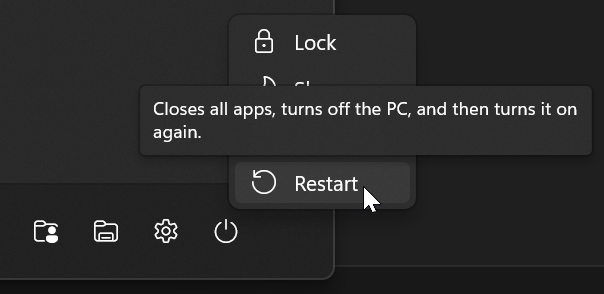
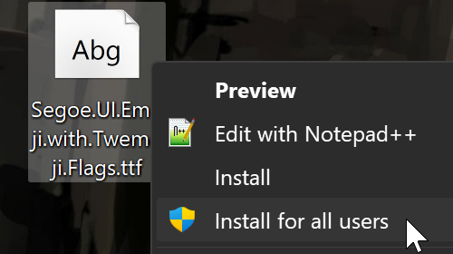
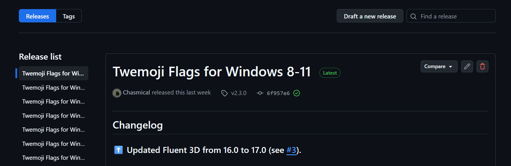
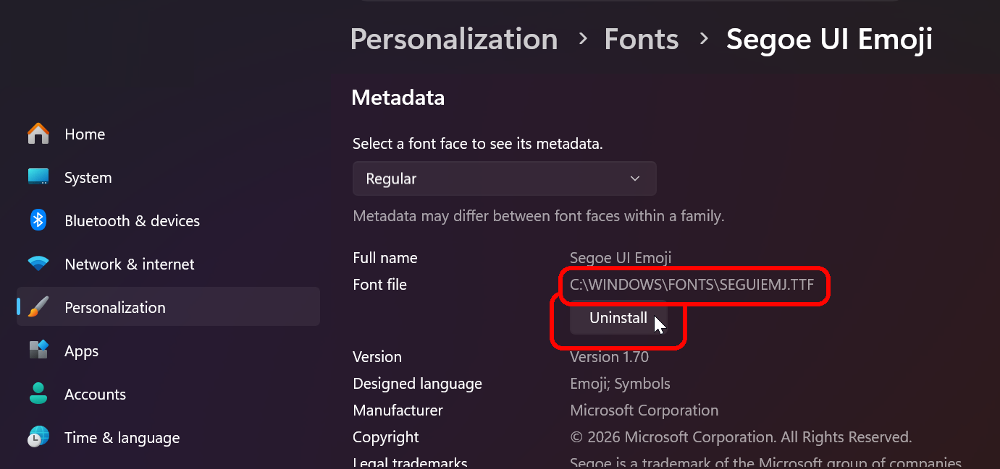
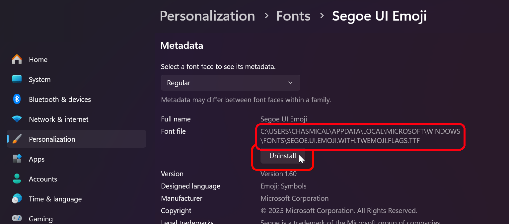
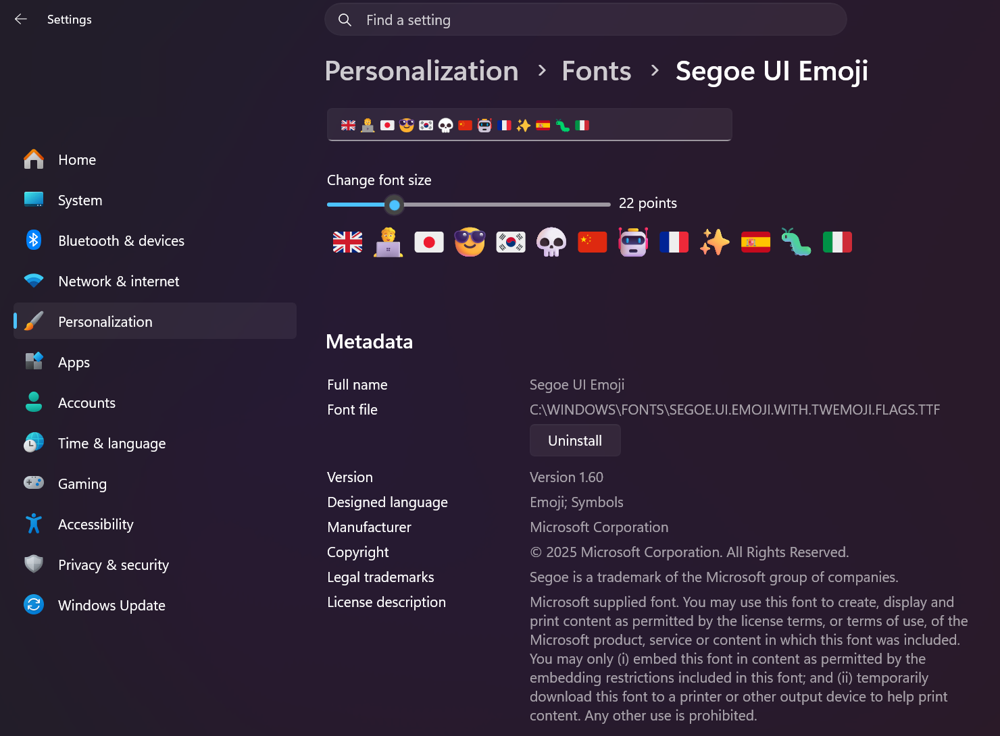
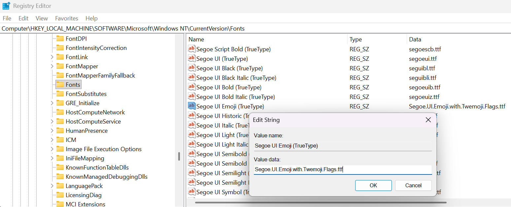
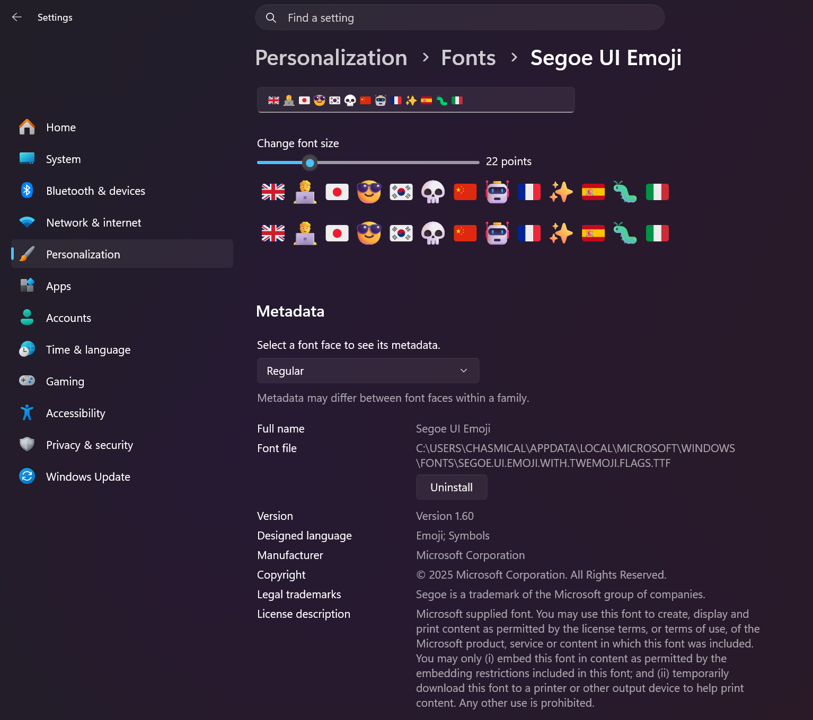

# Troubleshooting issues with the font

If the font is not working correctly after you installed it, go through the steps below.

If none of this helps, please [open an issue here](https://github.com/Chasmical/flag-emojis-for-windows/issues/new/choose)!

## Have you restarted your PC after installing the font?

Many programs only load the fonts once, since they don't really expect them to change over the
course of the program's execution. And even when they're closed, some software just goes dormant
mode instead of actually closing, or uses a font cache that's re-used on next launch. When you
restart the PC, all the programs, including the operating system itself, should start using the new
font file that you've just installed.



## Does the font work here, but not anywhere else? `🇬🇧🇯🇵🇰🇷🇨🇳🇫🇷🇪🇸🇮🇹`

You must have installed the font through the regular "Install" option instead of "Install for all
users". As described in the Installation section, regular "Install" only affects a few certain apps:
Chromium-based browsers (Chrome, Opera, Vivaldi, etc.), and Electron-based apps (Discord, VS Code,
etc.). Re-install the font using the "Install for all users" option to make the font render
everywhere.



## Was it working before, until a certain Windows update?

A Windows update might have updated the Segoe UI Emoji font, overriding the one with the flags.
Check for a new version on [the Releases page](https://github.com/Chasmical/flag-emojis-for-windows/releases)
and install it if there's one available.

[](https://github.com/Chasmical/flag-emojis-for-windows/releases)

If there isn't a new version yet, **re-install** the latest available font with flags, then go to
"Settings > Personalization > Fonts", find and click on "Segoe UI Emoji", select the old font file
(that's located at `C:\WINDOWS\FONTS\SEGUIEMJ.TTF`) and press "Uninstall". Now Windows should use
the one with the flags.



## Does your Windows account have any restrictions or limited permissions?

Your employer/cohabitants may have limited your account's ability to install fonts, through group
policies, user account control or the registry. There's no universal way to bypass those kinds of
restrictions, so I'd suggest you just ask them to install the font for you.

## I used the installer script, and all emojis are now black-and-white!

Huh, the installer script must have suffered some unexpected catastrophic failure. Please
[open an issue here](https://github.com/Chasmical/flag-emojis-for-windows/issues). This kind of
error shouldn't happen with manual installation, so download the font file, install it with
"Install for all users" option, and restart your PC.


## Everything is still broken, and/or I want to uninstall the font.

### With "Install for all users" (or installer script)

Open Terminal (PowerShell) and run this command to recover the original Segoe UI Emoji file:

```sh
Copy-Item "C:\Windows\Fonts\seguiemj.ttf" "~\Desktop"
```

This will copy the original font file to your desktop. Install it with "Install for all users",
and then restart your PC.

You can also get rid of leftover font files by running this:

```sh
Remove-Item "C:\Windows\Fonts\Segoe.UI.Emoji.with.Twemoji.Flags.*"
```

### With regular "Install" (this user)

Simply go to "Settings > Personalization > Fonts", find and click on "Segoe UI Emoji", select the
font file with the longest path and press "Uninstall". You should still have the original font file
installed system-wide in there.




# Parameters of a correct font installation *(Advanced)*

If the font is still somehow not working, and you're experienced enough with Windows (or if you've
been modding your Windows and suspect it might have something to do with this), here's some details
on what a correctly installed font should look like.

## With "Install for all users"

When you go to "Settings > Personalization > Fonts", and click on "Segoe UI Emoji", you should see
that there's only one font file installed (no dropdown selection), which should be located at
`C:\Windows\Fonts\Segoe.UI.Emoji.with.Twemoji.Flags.ttf`. The name may have an underscore followed
by a hexadecimal number (e.g. `C:\Windows\Fonts\Segoe.UI.Emoji.with.Twemoji.Flags_0.ttf`),
indicating how many times the font was re-installed. The installer script automatically tries to
clean up old font files, so that number generally shouldn't go beyond `_0`, unless you've been
installing the font manually.



In the Registry Editor, if you go to `HKLM\SOFTWARE\Microsoft\Windows NT\CurrentVersion\Fonts`,
you should find an entry named "Segoe UI Emoji (TrueType)" with the installed font file's name.



> [!WARNING]
> Note that the registry editing alone can't properly install the font. The font file **also** needs
> to be registered in the Windows GDI API, and then you need to emit a `WM_FONTCHANGE` event, which
> is usually done either through manual right-click install, or with the installer script.

## With regular "Install" (this user)

When you go to "Settings > Personalization > Fonts", and click on "Segoe UI Emoji", you should see
that there are **two** font files installed (use the dropdown to switch between their metadata).
The first one should be at `C:\Windows\Fonts\seguiemj.ttf` (that's the original, system-wide
installed font). And the second one should be at
`C:\Users\<UserName>\AppData\Local\Microsoft\Windows\Fonts\Segoe.UI.Emoji.with.Twemoji.Flags.ttf`
(that's the user-installed font, that applies only to this account/profile).



> [!WARNING]
> I'm not sure where Windows registers user-only fonts, so you'll have to investigate that yourself.
> 
> I recommend doing the "Install for all users" option instead.


